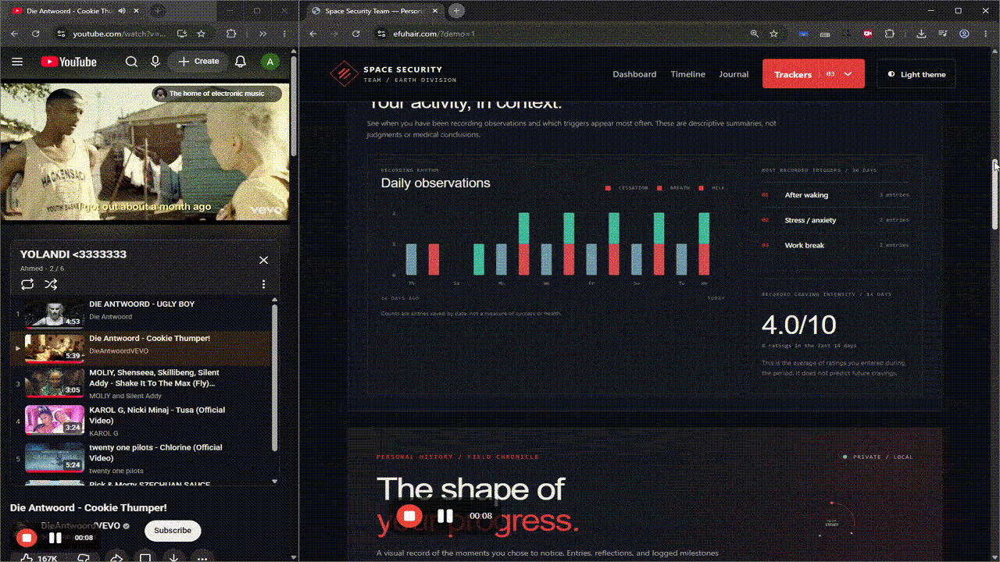
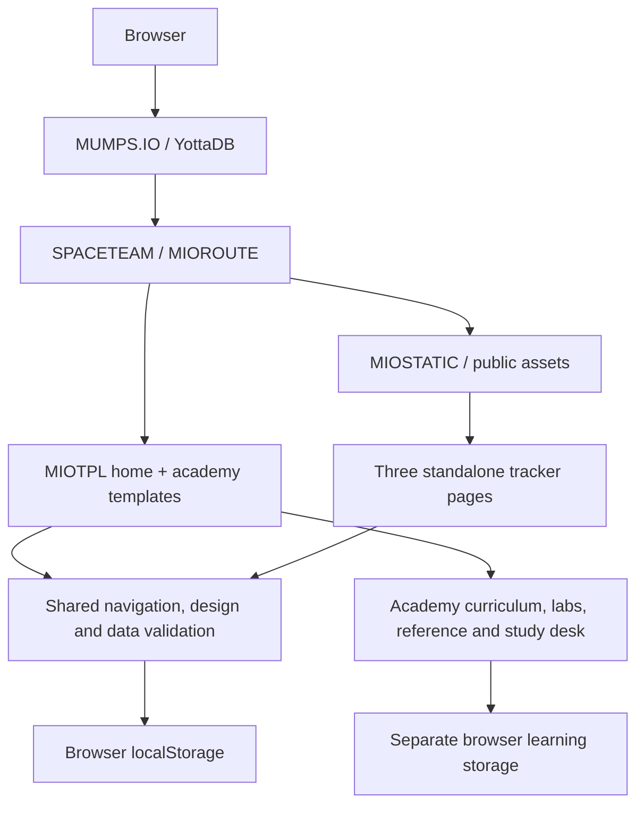

# Space Security Team

**Your observations. Your context. Your first programming language.**

Space Security Team is a personal observation and learning platform built on [MUMPS.IO](https://github.com/aa-87/mumps.io), YottaDB/GT.M and MIOTPL. It brings together three browser-local trackers, a private journal, a shared dashboard, and **MUMPS Academy**, a beginner-first programming course. The goal of the academy is simple: teach MUMPS as a first programming language, with visual learning, practical examples, and no required prior programming experience.

[**Start learning MUMPS**](https://efuhair.com/learn) · [Visual laboratories](https://efuhair.com/learn/lab) · [Language reference](https://efuhair.com/learn/reference) · [Learner guide](docs/MUMPS_LEARNING_GUIDE.md)

[Live project — efuhair.com](https://efuhair.com/) · [Sample dashboard](https://efuhair.com/?demo=1) · [Technical documentation](docs/SPACE_SECURITY_LANDING_PAGE.md) · [Browser CI](https://github.com/aa-87/efuhair.com/actions/workflows/browser-tests.yml)

[](https://github.com/aa-87/efuhair.com/actions/workflows/browser-tests.yml)

**Status:** Foundations 1.0 release candidate (academy); the personal workspace retains its earlier v0.1.0 release-candidate history. The current source includes the study desk and all 50 lessons. Browser/model CI has passed on the implementation baseline, but manual lesson review, real YottaDB verification and final release acceptance remain outstanding. The live deployment may lag behind repository changes. CI is not certification of the live MUMPS server or ANSI/ISO conformance.



*Recorded project demonstration; appearance may differ from the current release candidate.*

## Contents

- [MUMPS Academy](#mumps-academy)
- [Application features](#application-features)
- [Architecture](#architecture)
- [Repository structure](#repository-structure)
- [Installation and deployment](#installation-and-deployment)
- [Routes and static configuration](#routes-and-static-configuration)
- [Local records and backups](#local-records-and-backups)
- [Development and testing](#development-and-testing)
- [Privacy and safety](#privacy-and-safety)
- [Release checkpoints and roadmap](#release-checkpoints-and-roadmap)
- [Contributing and licensing](#contributing-and-licensing)

## MUMPS Academy

**Learn MUMPS from the beginning. See what your programs do. Build something of your own.**

The academy is free to access without an account. Guided browser lessons require no local MUMPS installation. YottaDB is the chosen implementation for executing real programs; the course teaches full command names and standard language concepts first, with environment-specific material explicitly identified.

| Curriculum | Visual learning | Study tools |
| --- | --- | --- |
| 50 lessons in 5 modules | 10 interactive laboratories | Module progress and resumption |
| 196 prepared instruction states | Code, memory and output diagrams | Bookmarks and course search |
| 50 module-review questions (10 per module) | Bounded experiments and debugging | Learning backup and practice downloads |
| 30 language reference entries | Four practical project milestones | Browser-local completion records |

### Learning path

| Module | Lessons | Learn to | Practical outcome |
| --- | --- | --- | --- |
| 01 — Programming fundamentals | [01–10](https://efuhair.com/learn/lesson/01) | Use WRITE, SET, READ, expressions, IF/ELSE and FOR | Save a first routine |
| 02 — Hierarchical information | [11–20](https://efuhair.com/learn/lesson/11) | Model sparse trees, traverse subscripts and use globals | Persistent contact directory |
| 03 — Program construction | [21–30](https://efuhair.com/learn/lesson/21) | Understand DO, QUIT, NEW, parameters and extrinsic functions | Reusable calculator |
| 04 — Visual data manipulation | [31–40](https://efuhair.com/learn/lesson/31) | Use string functions, conditional selection and patterns | Record formatter |
| 05 — Complete application development | [41–50](https://efuhair.com/learn/lesson/41) | Model records, validate input, implement CRUD, understand locks and transactions, and test contracts | Persistent terminal journal |

Follow the cycle **Read → See → Manipulate → Predict → Write → Build**. Step through a lesson, inspect its working memory and output, try the related laboratory, answer the knowledge check, then run or modify a real example in a configured learning environment. Module assessments reuse lesson questions for practice; they do not automatically complete lessons or award certification.

### Visual laboratories

| Laboratory | Explore |
| --- | --- |
| [Information trees](https://efuhair.com/learn/lab/trees) | SET, KILL, $DATA, $GET, $ORDER |
| [Expressions](https://efuhair.com/learn/lab/expressions) | Left-to-right evaluation and parentheses |
| [Control flow](https://efuhair.com/learn/lab/flow) | Decisions, $TEST and bounded loops |
| [Persistent memory](https://efuhair.com/learn/lab/memory) | Local/global distinction and simulated process restart |
| [Routine calls and scope](https://efuhair.com/learn/lab/routines) | Call frames, NEW, value/reference parameters and returns |
| [Program construction](https://efuhair.com/learn/lab/construction) | Instruction selection and debugging |
| [String manipulation](https://efuhair.com/learn/lab/strings) | $LENGTH, $EXTRACT, $FIND, $PIECE and $TRANSLATE |
| [Patterns and selection](https://efuhair.com/learn/lab/patterns) | Fixed patterns, $SELECT and record formatting |
| [Application builder](https://efuhair.com/learn/lab/application) | Fictional journal records and CRUD contracts |
| [Reliability](https://efuhair.com/learn/lab/reliability) | Cooperative locks, commit and rollback |

The browser models are deliberately bounded demonstrations, not a general interpreter, debugger or database engine. No arbitrary M code is executed on the public server. Labs reset in memory; they never access the personal journal or tracker records.

### Try your first MUMPS instruction

In YottaDB Direct Mode (after configuring your local learning environment):

```mumps
WRITE "Hello, world!",!
```

MUMPS is also known as M. Its language integrates commands, expressions, hierarchical variables and persistent global data. For example, a local variable can contain both a value and descendants:

```mumps
SET contact("Alex")="Friend"
SET contact("Alex","city")="Boston"
WRITE $DATA(contact("Alex")),!
WRITE contact("Alex","city"),!
```

Expected output: 11 followed by Boston on the next line. Local variables are process-local; global references begin with a caret and refer to database-backed storage in a configured environment.

### Learning resources and release status

- [Learner guide: setup, syntax, practice and projects](docs/MUMPS_LEARNING_GUIDE.md)
- [Foundations 1.0 release-candidate notes and manual review checklist](docs/ACADEMY_FOUNDATIONS_1_0.md)
- [YottaDB Programmer's Guide](https://docs.yottadb.com/ProgrammersGuide/)
- [YottaDB language features](https://docs.yottadb.com/ProgrammersGuide/langfeat.html), [commands](https://docs.yottadb.com/ProgrammersGuide/commands.html), [functions](https://docs.yottadb.com/ProgrammersGuide/functions.html) and [implementation extensions](https://docs.yottadb.com/ProgrammersGuide/langext.html)
- [YottaDB administration and setup](https://docs.yottadb.com/AdminOpsGuide/basicops.html)

The curriculum is guided by ANSI/MDC X11.1-1995 and ISO/IEC 11756:1999; it is not a complete standards specification or independently certified implementation. The reference is introductory. Use a disposable YottaDB database for all global-writing, locking and transaction examples. Real-runtime verification and an independent final practical assessment remain release-readiness work.

## Application features

| Module | Purpose | Entry point |
| --- | --- | --- |
| Command dashboard | Cross-log totals, recent activity, 14-day chart and descriptive craving/trigger summaries | [Home](https://efuhair.com/) |
| Field Log 001 | Cigarettes, cravings, triggers, personal milestones, retrospective composition observations and baseline/profile | [Cessation](https://efuhair.com/public/space-security/tracker/index.html) |
| Field Log 002 | Retrospective breath duration, date, context and notes | [Breath](https://efuhair.com/public/space-security/breath-log/index.html) |
| Field Log 003 | Dairy type, milk volume, calcium intake/source, digestive symptoms and context | [Milk](https://efuhair.com/public/space-security/milk-log/index.html) |
| Field Chronicle | Date-grouped chronological records, annual SVG chart, search, date/category filters and incremental browsing | [Timeline](https://efuhair.com/#timeline) |
| Private journal | Create, edit, delete, search and filter reflections associated with individual trackers or all trackers | [Journal](https://efuhair.com/#journal-title) |
| Data management | Complete JSON backup, validated merge or replacement, and cancellation | [Backups](https://efuhair.com/#data-management) |
| MUMPS Academy | Beginner-first lessons, visual labs, reference and study desk | [Learn MUMPS](https://efuhair.com/learn) |

All three trackers support record creation, correction, deletion and individual JSON portability. A common responsive navigation header provides a single Trackers dropdown, active-page identification, links to the dashboard, timeline, journal and academy, and shared dark/light themes. The interface is responsive and uses local SVG graphics without a charting library.

The optional read-only demonstration at `/?demo=1` provides 72 fictional records (18 per tracker/journal). Its charts use a separate in-memory dataset. Journal edits and backup controls are disabled there. Theme preferences remain shared; opening a tracker exits the sample dashboard and opens the normal personal page.

## Architecture

Space Security Team is a traditional multi-page application (MPA), intentionally designed to feel like one coherent application without an SPA framework, client-side router, or front-end build pipeline.



The server renders the root page and academy routes, and serves static files. Personal records are processed in the browser; no personal-record API, account database or cloud sync is implemented. The dashboard calculations are read-only, while the tracker and journal controllers handle edits. Node.js and Playwright are development tools only.

## Repository structure

```text
efuhair.com/
├── .github/workflows/browser-tests.yml
├── .gitignore
├── README.md
├── routines/
│   └── SPACETEAM.m
├── templates/
│   ├── layouts/space_security_layout.html
│   ├── pages/space_security_home.html
│   └── pages/space_security_academy.html
├── public/space-security/
│   ├── space-security.css
│   ├── shared-navigation.css
│   ├── shared-navigation.js
│   ├── design-system.css
│   ├── local-data.js
│   ├── dashboard.js
│   ├── journal.js
│   ├── demo.js
│   ├── tracker/index.html
│   ├── breath-log/index.html
│   ├── milk-log/index.html
│   └── academy/
│       ├── index.html, academy.css, academy.js
│       ├── curriculum.js, lab.js, lab-model.js
│       ├── construction.js, construction-model.js
│       ├── strings.js, string-model.js, reference.js
│       ├── application.js, application-model.js
│       ├── study.js, study-model.js
│       └── projects/SSTJOURNAL.m.txt
├── scripts/sync-to-mumpsio.sh
├── playwright.config.cjs
├── tests/
│   ├── local-data.test.js
│   ├── browser-server.cjs
│   ├── academy-model.test.cjs
│   ├── construction-model.test.cjs
│   ├── string-model.test.cjs
│   ├── application-model.test.cjs
│   ├── study-model.test.cjs
│   ├── academy-yottadb.test.cjs
│   └── browser/ (application, academy and quality specs)
└── docs/
    ├── SPACE_SECURITY_LANDING_PAGE.md
    ├── FIELD_LOG_001.md
    ├── BREATH_FIELD_LOG_CONCEPT.md
    ├── STABILIZATION_CHECKPOINT.md
    ├── RELEASE_CANDIDATE_0_1_0.md
    ├── MUMPS_LEARNING_GUIDE.md
    ├── ACADEMY_FOUNDATIONS_1_0.md
    ├── ACADEMY_FOUNDATIONS_0_2.md through ACADEMY_FOUNDATIONS_0_5.md
    └── fuh.gif
```

The shared data module defines validation, backup compatibility, optimistic stale-write checks and best-effort restore rollback. The shared navigation and design assets establish the common UI convention for future trackers.

## Installation and deployment

### Prerequisites

- Linux/Ubuntu with Bash and Git.
- A working MUMPS.IO checkout and configured YottaDB or GT.M environment for production.
- Node.js 22 and npm **only** for local development tests.

### Obtain the repositories

For a fresh sibling-directory installation:

```bash
git clone https://github.com/aa-87/mumps.io.git
git clone https://github.com/aa-87/efuhair.com.git
cd efuhair.com
```

Set up the MUMPS.IO environment according to its own documentation first. If both repositories already exist, do not clone them again.

### Synchronize application files

```bash
git pull --ff-only origin main
bash scripts/sync-to-mumpsio.sh ../mumps.io
```

The script accepts an absolute target path as well. It copies the application routine, templates, entire `public/space-security/` tree and selected integration documents. It does not replace the target repository's top-level README. It overwrites the matching application files, so preserve local changes before synchronization. Keep personal backups outside the public directory.

### Register routes

Add the module to the existing MUMPS.IO startup sequence:

```mumps
D INIT^MIOROUTE
D START^MIOTPL(.CONF)
D REG^SPACETEAM(.CONF)
D COMPILE^MIOROUTE
```

If initialization and MIOTPL startup already occur elsewhere, register only `REG^SPACETEAM` before the existing route compilation. Do not initialize twice or register duplicate routes. Ensure any existing root/static route conflicts are resolved in the host application. Refresh the MIOTPL template cache or restart the server using the host's normal procedure.

## Routes and static configuration

| Method | Path | Handler |
| --- | --- | --- |
| GET | `/` | `HOME^SPACETEAM` |
| GET | `/space-security` | Legacy alias for the home page |
| GET / HEAD | `/public/*path` | `STATIC^SPACETEAM` |
| GET | `/?demo=1` | Same home route; browser-side demo selection |
| GET | `/learn`, `/learn/foundations` | Academy home and study desk (`ACADEMY^SPACETEAM`) |
| GET | `/learn/lesson/01` through `/learn/lesson/50` | Guided lessons |
| GET | `/learn/lab`, `/learn/lab/{name}` | Lab overview and ten registered labs (see table above) |
| GET | `/learn/reference` | Searchable language reference and setup guide |

**Preserve the confirmed working MIOSTATIC configuration:**

```mumps
SET CONF("server","static","mount")="/public"
SET CONF("server","static","root")="public"
DO STATIC^MIOSTATIC(.DEV,.CONF,.REQ,.CTX)
```

The request path `/public/space-security/space-security.css` resolves to the file `public/space-security/space-security.css` relative to the host's static root convention. Do not substitute `/public/space-security` as the mount while retaining `public` as the root, or add a competing static route.

If CSS or trackers return 404, check that the sync script copied the assets, the server is using the expected working directory, and the mount/root pair matches the above. If an older home page appears, check the template cache and hard-refresh the browser.

## Local records and backups

| Storage key | Contents |
| --- | --- |
| `sst.fieldlog.v1` | Cessation entries, profile and legacy theme |
| `sst.breathlog.v1` | Breath observation array |
| `sst.milklog.v1` | Milk/dairy observation array |
| `sst.journal.v1` | Reflection array |
| `sst.landing.theme` | Shared light/dark preference |
| `sst.academy.progress.v1` | Completed lesson IDs |
| `sst.academy.study.v1` | Bookmarks and last-visited lesson |

The existing versioned complete backup format is `sst-complete-backup-v1`. It contains all three tracker datasets, the journal, and the theme preference. Restore validates the document before writing, rejects duplicate IDs, and supports merge, replacement or cancellation. Merge deduplicates by ID, with incoming records taking precedence. Older backups without a milk dataset preserve the existing milk records. The import limit is 5 MB.

The data contract rejects stale writes when the loaded storage value differs from the current value. This is an optimistic guard, not a cross-tab lock or atomic transaction. Multi-key restore attempts rollback on failure, but rollback can itself fail. Export a current backup before restoring and close other application tabs.

Academy learning data has a separate `sst-academy-backup-v1` export/import format (64 KiB import limit). Import merges validated lesson IDs and bookmarks and retains an existing last-visited lesson if present. It does not modify the tracker/journal backup. Export both backup types separately before moving to another device. Multi-key learning restore uses optimistic checks and best-effort rollback, not an atomic transaction.

Journal scopes include general, cessation, breath, milk and all trackers. The legacy `both` scope remains cessation plus breath.

## Development and testing

### Data and academy model regression suites

```bash
node tests/local-data.test.js
node tests/academy-model.test.cjs
node tests/construction-model.test.cjs
node tests/string-model.test.cjs
node tests/application-model.test.cjs
node tests/study-model.test.cjs
```

The suites cover tracker validation and backups, curriculum structure, teaching models, construction choices, string and pattern boundaries, application contracts, and portable study state. They have no third-party test dependency.

### Browser suite

```bash
npm install --no-save --no-package-lock @playwright/test@1.51.1
npx playwright install --with-deps chromium
npx playwright test
```

For a front-end-only development preview, run `node tests/browser-server.cjs` and open `http://127.0.0.1:4173/`. Stop that process before running the automated suite, which starts its own fixture server.

The fixture combines the actual MIOTPL layout and page using simple placeholder substitution and serves the public assets. This tests the browser interface, not the YottaDB/MIOTPL runtime. Chromium desktop and mobile emulation cover navigation, theme persistence, tracker editing, journal and timeline, sample-mode isolation and backup workflows, academy lessons and laboratories, study tools, and responsive quality checks at 320, 375, 430 and 768 px in both themes. Mobile emulation is not a substitute for testing Safari or a physical iPhone.

GitHub Actions runs the data and browser suites on pushes, pull requests and manual dispatch. The workflow uses Node.js 24-compatible action runtimes while installing Node.js 22 for test commands. Failed browser-test artifacts are uploaded for diagnosis. Use synthetic records only in tests, traces and screenshots.

### Actual YottaDB verification (opt-in)

After configuring a fresh disposable learning database with its own global directory and underlying database files, verify the examples using:

```bash
SST_LEARNING_DATABASE=YES node tests/academy-yottadb.test.cjs
```

**Never use production database mappings.** The harness writes fictional learning globals and checks expected output across processes. It is not part of browser CI. See the [manual verification guide](docs/ACADEMY_FOUNDATIONS_1_0.md) for prerequisites, limitations and acceptance checks.

Review [CI results](https://github.com/aa-87/efuhair.com/actions) and the [browser acceptance checklist](docs/STABILIZATION_CHECKPOINT.md) before promoting a release. Test the actual deployed MUMPS application separately.

## Privacy and safety

- Records are browser-local and scoped to the exact origin and browser profile. Different hostnames, protocols, devices or profiles do not share records automatically.
- Local storage and JSON exports are **not encrypted** by this application. Browser clearing, eviction or profile loss can erase data. Keep backups privately, outside the web root and repository.
- The project does not require accounts or upload tracker records. Normal HTTP access may still appear in server logs. Full offline reload support is not implemented.
- These are personal observation tools, not diagnostic devices, medical advice, or evidence of treatment effectiveness. No HIPAA compliance claim is made.
- The cessation log records personal experiences with tobacco/cannabis; it does not recommend smoking or mixing them as a treatment.
- Breath records are retrospective, without timers, targets, rankings or coaching. Breath-holding can cause fainting or drowning; do not practice in water, while driving, alone, after hyperventilation, or where fainting could cause injury.
- The milk tracker documents the founder's unverified calcium/tolerance hypothesis. Calcium is not an established treatment for lactose intolerance and does not replace lactase. Do not increase supplement doses or provoke symptoms to test the hypothesis.

## Release checkpoints and roadmap

| Checkpoint | Purpose |
| --- | --- |
| [Pre-stabilization](https://github.com/aa-87/efuhair.com/tree/checkpoint/pre-stabilization-2026-11-25) | Recovery before data-integrity changes |
| [Stabilization](https://github.com/aa-87/efuhair.com/tree/checkpoint/stabilization-2026-11-25) | Shared validation and tracker editing |
| [v0.1.0-rc1](https://github.com/aa-87/efuhair.com/tree/checkpoint/v0.1.0-rc1) | Dashboard-first UX, demo and automated browser suite |

Academy history: [0.2](docs/ACADEMY_FOUNDATIONS_0_2.md) · [0.3](docs/ACADEMY_FOUNDATIONS_0_3.md) · [0.4](docs/ACADEMY_FOUNDATIONS_0_4.md) · [0.5](docs/ACADEMY_FOUNDATIONS_0_5.md) · [1.0 release candidate](docs/ACADEMY_FOUNDATIONS_1_0.md).

Current priority: manual lesson review, actual YottaDB execution and live desktop/mobile acceptance before declaring a verified Foundations 1.0 release. Future work includes an independent practical assessment, stronger offline reload support, encrypted backup options and private beta feedback. These are planned, not current features.

See [release candidate notes](docs/RELEASE_CANDIDATE_0_1_0.md) and [stabilization/rollback instructions](docs/STABILIZATION_CHECKPOINT.md).

## Contributing and licensing

Keep the root URL, shared Trackers dropdown, dark/light theme, local data contracts and MUMPS.IO static configuration intact. Prefer framework-free browser code, reuse shared assets, and update tests and documentation whenever changing persistence or record schemas. Do not commit real personal records, exported backups, credentials or generated test artifacts.

Report reproducible issues with the browser, viewport, commit and synthetic steps to reproduce in [GitHub Issues](https://github.com/aa-87/efuhair.com/issues). Never include personal tracker data.

No standalone LICENSE file was found during the repository review. Do not assume a public repository grants permission to redistribute or modify its code. Existing source notices remain unchanged; licensing terms should be established by the repository owner before a wider release.

