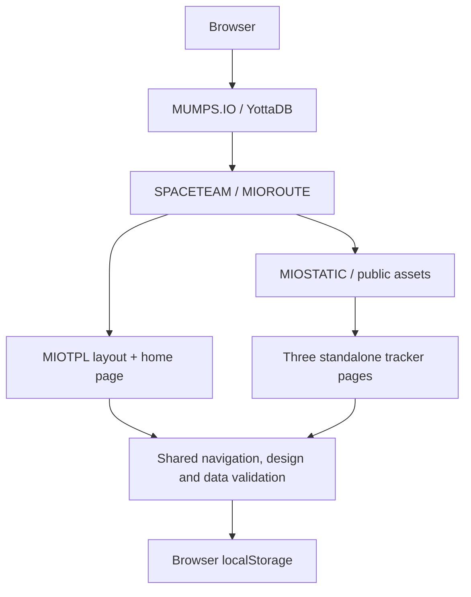

# Space Security Team

**Your observations. Your context.**

A privacy-first personal observation workspace built on [MUMPS.IO](https://github.com/aa-87/mumps.io), YottaDB/GT.M and the MIOTPL server-side templating engine. Three specialized trackers, one private journal, and a shared dashboard help users record and revisit personal experiences without accounts, cloud synchronization, or gamification.

[Live project — efuhair.com](https://efuhair.com/) · [Sample dashboard](https://efuhair.com/?demo=1) · [Technical documentation](docs/SPACE_SECURITY_LANDING_PAGE.md) · [Browser CI](https://github.com/aa-87/efuhair.com/actions/workflows/browser-tests.yml)

[](https://github.com/aa-87/efuhair.com/actions/workflows/browser-tests.yml)

**Status:** v0.1.0 release candidate. The live codename deployment may lag behind repository changes. The CI badge reports automated fixture tests, not certification of the live MUMPS server.


*Recorded project demonstration; appearance may differ from the current release candidate.*

## Contents

- [Application features](#application-features)
- [Architecture](#architecture)
- [Repository structure](#repository-structure)
- [Installation and deployment](#installation-and-deployment)
- [Routes and static configuration](#routes-and-static-configuration)
- [Local records and backups](#local-records-and-backups)
- [Development and testing](#development-and-testing)
- [Privacy and safety](#privacy-and-safety)
- [Release checkpoints and roadmap](#release-checkpoints-and-roadmap)
- [Contributing and licensing](#contributing-and-licensing)

## Application features

| Module | Purpose | Entry point |
| --- | --- | --- |
| Command dashboard | Cross-log totals, recent activity, 14-day chart and descriptive craving/trigger summaries | [Home](https://efuhair.com/) |
| Field Log 001 | Cigarettes, cravings, triggers, personal milestones, retrospective composition observations and baseline/profile | [Cessation](https://efuhair.com/public/space-security/tracker/index.html) |
| Field Log 002 | Retrospective breath duration, date, context and notes | [Breath](https://efuhair.com/public/space-security/breath-log/index.html) |
| Field Log 003 | Dairy type, milk volume, calcium intake/source, digestive symptoms and context | [Milk](https://efuhair.com/public/space-security/milk-log/index.html) |
| Field Chronicle | Date-grouped chronological records, annual SVG chart, search, date/category filters and incremental browsing | [Timeline](https://efuhair.com/#timeline) |
| Private journal | Create, edit, delete, search and filter reflections associated with individual trackers or all trackers | [Journal](https://efuhair.com/#journal-title) |
| Data management | Complete JSON backup, validated merge or replacement, and cancellation | [Backups](https://efuhair.com/#data-management) |

All three trackers support record creation, correction, deletion and individual JSON portability. A common sticky navigation header provides a single Trackers dropdown, active-page identification, links to the dashboard, timeline and journal, and shared dark/light themes. The interface is responsive and uses local SVG graphics without a charting library.

The optional read-only demonstration at `/?demo=1` provides 72 fictional records (18 per tracker/journal). Its charts use a separate in-memory dataset. Journal edits and backup controls are disabled there. Theme preferences remain shared; opening a tracker exits the sample dashboard and opens the normal personal page.

## Architecture

Space Security Team is a traditional multi-page application (MPA), intentionally designed to feel like one coherent application without an SPA framework, client-side router, or front-end build pipeline.



The server renders the root page and serves static files. Personal records are processed in the browser; no personal-record API, account database or cloud sync is implemented. The dashboard calculations are read-only, while the tracker and journal controllers handle edits. Node.js and Playwright are development tools only.

## Repository structure

```text
efuhair.com/
├── .github/workflows/browser-tests.yml
├── .gitignore
├── README.md
├── routines/
│   └── SPACETEAM.m
├── templates/
│   ├── layouts/space_security_layout.html
│   └── pages/space_security_home.html
├── public/space-security/
│   ├── space-security.css
│   ├── shared-navigation.css
│   ├── shared-navigation.js
│   ├── design-system.css
│   ├── local-data.js
│   ├── dashboard.js
│   ├── journal.js
│   ├── demo.js
│   ├── tracker/index.html
│   ├── breath-log/index.html
│   └── milk-log/index.html
├── scripts/sync-to-mumpsio.sh
├── playwright.config.cjs
├── tests/
│   ├── local-data.test.js
│   ├── browser-server.cjs
│   └── browser/application.spec.cjs
└── docs/
    ├── SPACE_SECURITY_LANDING_PAGE.md
    ├── FIELD_LOG_001.md
    ├── BREATH_FIELD_LOG_CONCEPT.md
    ├── STABILIZATION_CHECKPOINT.md
    ├── RELEASE_CANDIDATE_0_1_0.md
    └── efuhair.gif
```

The shared data module defines validation, backup compatibility, optimistic stale-write checks and best-effort restore rollback. The shared navigation and design assets establish the common UI convention for future trackers.

## Installation and deployment

### Prerequisites

- Linux/Ubuntu with Bash and Git.
- A working MUMPS.IO checkout and configured YottaDB or GT.M environment for production.
- Node.js 22 and npm **only** for local development tests.

### Obtain the repositories

For a fresh sibling-directory installation:

```bash
git clone https://github.com/aa-87/mumps.io.git
git clone https://github.com/aa-87/efuhair.com.git
cd efuhair.com
```

Set up the MUMPS.IO environment according to its own documentation first. If both repositories already exist, do not clone them again.

### Synchronize application files

```bash
git pull --ff-only origin main
bash scripts/sync-to-mumpsio.sh ../mumps.io
```

The script accepts an absolute target path as well. It copies the application routine, templates, entire `public/space-security/` tree and selected integration documents. It does not replace the target repository's top-level README. It overwrites the matching application files, so preserve local changes before synchronization. Keep personal backups outside the public directory.

### Register routes

Add the module to the existing MUMPS.IO startup sequence:

```mumps
D INIT^MIOROUTE
D START^MIOTPL(.CONF)
D REG^SPACETEAM(.CONF)
D COMPILE^MIOROUTE
```

If initialization and MIOTPL startup already occur elsewhere, register only `REG^SPACETEAM` before the existing route compilation. Do not initialize twice or register duplicate routes. Ensure any existing root/static route conflicts are resolved in the host application. Refresh the MIOTPL template cache or restart the server using the host's normal procedure.

## Routes and static configuration

| Method | Path | Handler |
| --- | --- | --- |
| GET | `/` | `HOME^SPACETEAM` |
| GET | `/space-security` | Legacy alias for the home page |
| GET / HEAD | `/public/*path` | `STATIC^SPACETEAM` |
| GET | `/?demo=1` | Same home route; browser-side demo selection |

**Preserve the confirmed working MIOSTATIC configuration:**

```mumps
SET CONF("server","static","mount")="/public"
SET CONF("server","static","root")="public"
DO STATIC^MIOSTATIC(.DEV,.CONF,.REQ,.CTX)
```

The request path `/public/space-security/space-security.css` resolves to the file `public/space-security/space-security.css` relative to the host's static root convention. Do not substitute `/public/space-security` as the mount while retaining `public` as the root, or add a competing static route.

If CSS or trackers return 404, check that the sync script copied the assets, the server is using the expected working directory, and the mount/root pair matches the above. If an older home page appears, check the template cache and hard-refresh the browser.

## Local records and backups

| Storage key | Contents |
| --- | --- |
| `sst.fieldlog.v1` | Cessation entries, profile and legacy theme |
| `sst.breathlog.v1` | Breath observation array |
| `sst.milklog.v1` | Milk/dairy observation array |
| `sst.journal.v1` | Reflection array |
| `sst.landing.theme` | Shared light/dark preference |

The existing versioned complete backup format is `sst-complete-backup-v1`. It contains all three tracker datasets, the journal, and the theme preference. Restore validates the document before writing, rejects duplicate IDs, and supports merge, replacement or cancellation. Merge deduplicates by ID, with incoming records taking precedence. Older backups without a milk dataset preserve the existing milk records. The import limit is 5 MB.

The data contract rejects stale writes when the loaded storage value differs from the current value. This is an optimistic guard, not a cross-tab lock or atomic transaction. Multi-key restore attempts rollback on failure, but rollback can itself fail. Export a current backup before restoring and close other application tabs.

Journal scopes include general, cessation, breath, milk and all trackers. The legacy `both` scope remains cessation plus breath.

## Development and testing

### Data regression suite

```bash
node tests/local-data.test.js
```

The suite covers validation, duplicate IDs, merge/replacement, legacy backups, stale-write rejection and simulated rollback. It has no third-party test dependency.

### Browser suite

```bash
npm install --no-save --no-package-lock @playwright/test@1.51.1
npx playwright install --with-deps chromium
npx playwright test
```

For a front-end-only development preview, run `node tests/browser-server.cjs` and open `http://127.0.0.1:4173/`. Stop that process before running the automated suite, which starts its own fixture server.

The fixture combines the actual MIOTPL layout and page using simple placeholder substitution and serves the public assets. This tests the browser interface, not the YottaDB/MIOTPL runtime. Chromium desktop and mobile emulation cover navigation, theme persistence, tracker editing, journal and timeline, sample-mode isolation and backup workflows. Mobile emulation is not a substitute for testing Safari or a physical iPhone.

GitHub Actions runs the data and browser suites on pushes, pull requests and manual dispatch. The workflow uses Node.js 24-compatible action runtimes while installing Node.js 22 for test commands. Failed browser-test artifacts are uploaded for diagnosis. Use synthetic records only in tests, traces and screenshots.

Review [CI results](https://github.com/aa-87/efuhair.com/actions) and the [browser acceptance checklist](docs/STABILIZATION_CHECKPOINT.md) before promoting a release. Test the actual deployed MUMPS application separately.

## Privacy and safety

- Records are browser-local and scoped to the exact origin and browser profile. Different hostnames, protocols, devices or profiles do not share records automatically.
- Local storage and JSON exports are **not encrypted** by this application. Browser clearing, eviction or profile loss can erase data. Keep backups privately, outside the web root and repository.
- The project does not require accounts or upload tracker records. Normal HTTP access may still appear in server logs. Full offline reload support is not implemented.
- These are personal observation tools, not diagnostic devices, medical advice, or evidence of treatment effectiveness. No HIPAA compliance claim is made.
- The cessation log records personal experiences with tobacco/cannabis; it does not recommend smoking or mixing them as a treatment.
- Breath records are retrospective, without timers, targets, rankings or coaching. Breath-holding can cause fainting or drowning; do not practice in water, while driving, alone, after hyperventilation, or where fainting could cause injury.
- The milk tracker documents the founder's unverified calcium/tolerance hypothesis. Calcium is not an established treatment for lactose intolerance and does not replace lactase. Do not increase supplement doses or provoke symptoms to test the hypothesis.

## Release checkpoints and roadmap

| Checkpoint | Purpose |
| --- | --- |
| [Pre-stabilization](https://github.com/aa-87/efuhair.com/tree/checkpoint/pre-stabilization-2026-11-25) | Recovery before data-integrity changes |
| [Stabilization](https://github.com/aa-87/efuhair.com/tree/checkpoint/stabilization-2026-11-25) | Shared validation and tracker editing |
| [v0.1.0-rc1](https://github.com/aa-87/efuhair.com/tree/checkpoint/v0.1.0-rc1) | Dashboard-first UX, demo and automated browser suite |

Current priority: repository hygiene, passing CI, live desktop/mobile acceptance, and a verified v0.1.0 release. Future work includes private beta feedback, stronger offline reload support, encrypted backup options, and descriptive historical comparisons. These are planned, not current features.

See [release candidate notes](docs/RELEASE_CANDIDATE_0_1_0.md) and [stabilization/rollback instructions](docs/STABILIZATION_CHECKPOINT.md).

## Contributing and licensing

Keep the root URL, shared Trackers dropdown, dark/light theme, local data contracts and MUMPS.IO static configuration intact. Prefer framework-free browser code, reuse shared assets, and update tests and documentation whenever changing persistence or record schemas. Do not commit real personal records, exported backups, credentials or generated test artifacts.

Report reproducible issues with the browser, viewport, commit and synthetic steps to reproduce in [GitHub Issues](https://github.com/aa-87/efuhair.com/issues). Never include personal tracker data.

No standalone LICENSE file was found during the repository review. Do not assume a public repository grants permission to redistribute or modify its code. Existing source notices remain unchanged; licensing terms should be established by the repository owner before a wider release.


## MUMPS Academy — Foundations 0.5

Open `/learn` for fifty beginner-first lessons and ten visual laboratories. The final module teaches data modeling, CRUD, validation, separation of responsibilities, cooperative locking, transactions and testing, culminating in a downloadable MUMPS terminal journal. The searchable reference includes thirty entries. Standard constructs are taught first, with YottaDB environment and transaction behavior identified explicitly.

The browser laboratories are bounded simulations, not interpreters. Fictional journal records remain in memory and never access personal tracker data. Learning progress retains `sst.academy.progress.v1` and lesson IDs 01–40. No production dependency or personal storage changes.

See [Foundations 0.5](docs/ACADEMY_FOUNDATIONS_0_5.md) for verification, deployment and disposable YottaDB project instructions.
