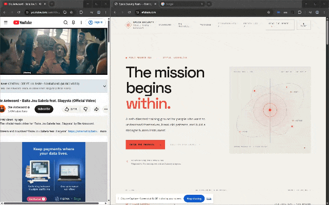

# Space Security Team  (https://efuhair.com)
 

A MUMPS.IO / MIOTPL project with a unified local-first command dashboard and two standalone, browser-local field logs.

## Project structure

- `routines/SPACETEAM.m` — root landing-page route and public static-file route.
- `templates/layouts/space_security_layout.html` — page shell and stylesheet reference.
- `templates/pages/space_security_home.html` — root command dashboard, live cross-log summaries, and project landing content.
- `public/space-security/space-security.css` — responsive landing/dashboard styling and shared theme support.
- `public/space-security/dashboard.js` — read-only cross-log dashboard controller.
- `public/space-security/tracker/index.html` — Field Log 001, smoking cessation observations.
- `public/space-security/breath-log/index.html` — Field Log 002, retrospective breath observation log.
- `scripts/sync-to-mumpsio.sh` — copies the project integration files into a local MUMPS.IO checkout.
- `docs/` — setup, product behavior, safety, privacy, and verification notes.

## Confirmed working MIOSTATIC configuration

The deployed application uses this exact mount/root pair in `STATIC^SPACETEAM`:

```mumps
SET CONF("server","static","mount")="/public"
SET CONF("server","static","root")="public"
DO STATIC^MIOSTATIC(.DEV,.CONF,.REQ,.CTX)
```

**Preserve this exact configuration for future changes.** The `/public/*path` route strips the `/public` URL prefix and resolves the remaining path under the `public/` filesystem directory. For example, `/public/space-security/space-security.css` maps to `public/space-security/space-security.css`.

Do not change the mount to `/public/space-security` while keeping the root as `public`; do not add a competing `/public/space-security/*path` route.

## Routes

- `GET /` — landing page.
- `GET /space-security` — legacy alias.
- `GET /public/*path` and `HEAD /public/*path` — static assets.

Both field logs and the landing stylesheet are served through the same public static route.

## Integrate into MUMPS.IO

From this repository, run:

```bash
chmod +x scripts/sync-to-mumpsio.sh
./scripts/sync-to-mumpsio.sh ../mumps.io
```

Pass the absolute path to your MUMPS.IO checkout if it is not a sibling directory. The script copies the routine, templates, public assets, and project documentation into their corresponding locations without overwriting MUMPS.IO's top-level README.

Register the module in the application's existing startup sequence, before route compilation:

```mumps
D INIT^MIOROUTE
D START^MIOTPL(.CONF)
D REG^SPACETEAM(.CONF)
D COMPILE^MIOROUTE
```

If route initialization and MIOTPL startup already occur elsewhere, add only `D REG^SPACETEAM(.CONF)` before the existing route compilation. Avoid registering the module twice.

## Field logs

### Field Log 001 — smoking cessation

A standalone local-first log for cigarette use, cravings, triggers, notes, and personal observations. It supports JSON export/import and deletion. User-entered tobacco/cannabis composition is recorded as personal observation, not recommended use or an evidence-based cessation treatment.

### Field Log 002 — breath observation

A standalone local-only log for durations entered retrospectively, date/time, optional context, and notes. It supports history, JSON export/import, and deletion. It deliberately has no live hold timer, countdown, targets, coaching, streaks, or performance scoring. Its safety notice explains fainting and drowning risks and advises against practicing in or near water, while driving or standing, alone, or after hyperventilation.

The founder's experience during leg-injury recovery is presented as personal history, not evidence that breath-holding improves cardiovascular fitness or replaces exercise.

## Privacy and limitations

Both field logs store data in the current browser profile using `localStorage`; they do not upload entries, require accounts, or use cloud synchronization. This app does not encrypt browser-local data. Anyone with access to the browser profile may be able to view it, and clearing browser storage may erase it. Users should export backups when needed.

These are personal tracking tools, not medical advice, diagnostic devices, or clinical services. The project does not claim HIPAA compliance.

## Unified command dashboard

The root page (`/`) reads both field logs from the same browser origin and displays combined counts, cessation summaries, the latest breath-observation duration, and a filterable recent-activity feed. It reads these existing local-storage keys:

- `sst.fieldlog.v1` — cessation tracker state, including `entries`.
- `sst.breathlog.v1` — breath-observation entry array.

The dashboard is a read-only view: it does not rewrite, merge, transmit, or migrate either log's data. Each tracker remains independently usable at its existing URL. Updates made in another tab are reflected through the browser `storage` event; returning to or refreshing the dashboard reloads its summaries.

The dashboard and both trackers share the `sst.landing.theme` preference for light/dark mode. Existing tracker data formats and storage keys remain unchanged. Because browser local storage is scoped to the exact origin, records created on a different domain, subdomain, protocol, or browser profile will not automatically appear here. Export/import remains the way to move backups between environments.


## Personal insights

The unified dashboard also provides descriptive, local-only insights:

- A rolling 14-day stacked activity chart showing how many cessation and breath-log records were entered on each day.
- The three most frequently entered cessation trigger labels over the previous 30 days. Labels are grouped without regard to capitalization.
- The average of recorded craving ratings from the previous 14 days.

These summaries are generated in the browser from existing local records. They do not infer causation, treatment effectiveness, health status, or breath-hold performance. Empty periods are shown as empty rather than interpreted as a lack of progress. No data is uploaded.


## Private journal and complete backup

The root dashboard includes a local-only reflection journal stored under `sst.journal.v1`. Notes can be tagged as general, cessation-related, breath-log-related, or connected to both logs. They can be searched, filtered, edited, and deleted. Journal records also appear in the combined recent-activity feed.

The dashboard's complete backup is a versioned JSON document (`sst-complete-backup-v1`) containing:

- The complete cessation field-log object, including its profile/baseline.
- Breath observation records.
- Journal reflections.
- The light/dark theme preference.

Restore validates the complete document before writing. The user chooses replacement or merge: replacement overwrites these four local-storage keys; merge deduplicates by record ID and gives imported records precedence on matching IDs. A failed storage write triggers a best-effort rollback. The import control limits files to 5 MB.

Backups are ordinary, unencrypted JSON files. Browser local storage is also not encrypted by this application. Treat both as sensitive personal information and store backup files privately. No account, server upload, or cloud synchronization is involved.


## Personal progress timeline

The root dashboard includes a visual Field Chronicle that combines the existing cessation, breath-observation, and private journal records into a chronological view. It adds a 12-month stacked SVG activity chart, descriptive record/day/reflection totals, date-grouped event cards, time-window and field filters, text search, and incremental loading.

The timeline reads (but does not modify) the existing `sst.fieldlog.v1`, `sst.breathlog.v1`, and `sst.journal.v1` local-storage records. Counts describe recorded activity only; they are not health outcomes, streaks, scores, or breath-hold performance goals. The timeline introduces no server endpoint, database, external dependency, or new storage key.

## Field Log 003 — Milk & dairy
Private retrospective milk volume, calcium intake/source, digestive symptoms and notes. The founder's calcium/tolerance hypothesis is unverified; calcium is not a proven lactose intolerance treatment. No prescribed doses or food challenges. Stored in `sst.milklog.v1`, included in the timeline and unified backup. Older backups without milk data preserve existing milk records. Open `/public/space-security/milk-log/index.html`. Existing static routes and sync script suffice.
